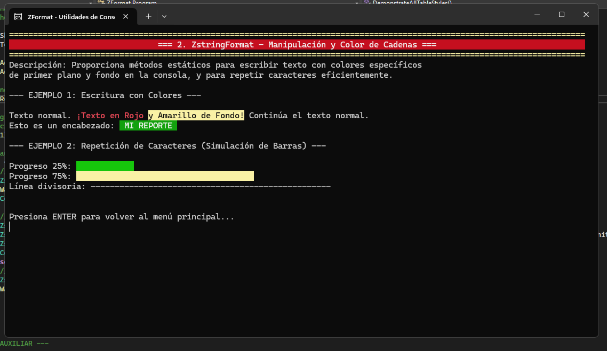
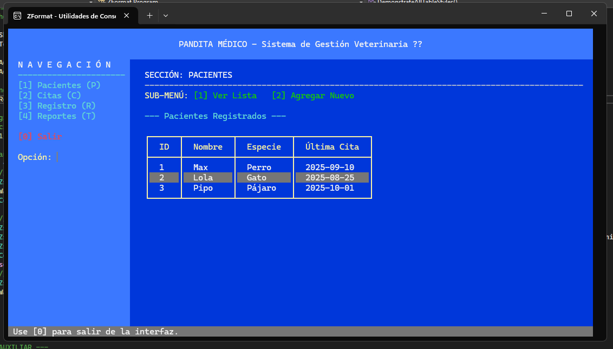
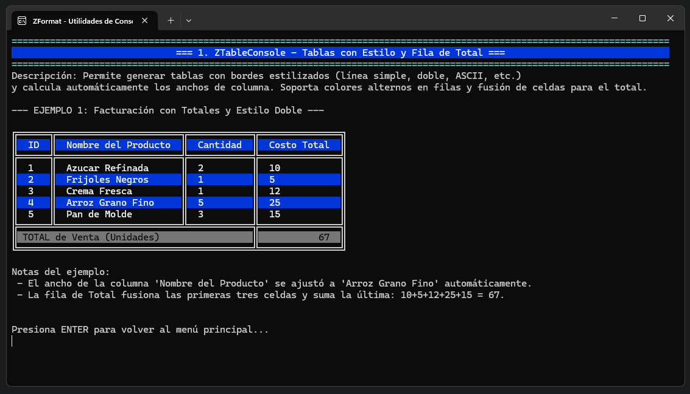

# 📚 ZFormat: Biblioteca de Utilidades para Consola (C#)

**ZFormat** es una colección de clases de ayuda en C# diseñada para mejorar dramáticamente la presentación y el acabado de las aplicaciones de consola y línea de comandos. Proporciona herramientas para el formato de cadenas, el control del cursor (`gotoxy`), la animación de carga, y la generación de tablas estilizadas con bordes y colores.

## 🎯 ¿Para Qué Sirve?

Su propósito principal es convertir las salidas de consola planas y monótonas en interfaces de texto dinámicas y visualmente atractivas, utilizando las capacidades avanzadas de la Terminal (como los caracteres Unicode para bordes y el control de color). Es ideal para:

1.  **Reportes y Listados:** Generar tablas de datos claras y fáciles de leer.
2.  **Interfaces de Usuario (TUI):** Crear menús, encabezados y paneles con una estética retro moderna o estilo DOS.
3.  **Animaciones y Feedback:** Mostrar barras de progreso y mensajes de error/éxito con color.

---

## 🛠️ Clases Incluidas en la DLL

La biblioteca se compone de cuatro elementos principales:

| Elemento | Descripción | Funcionalidades Clave |
| :--- | :--- | :--- |
| **ZstringFormat** | Utilidades de texto, color, y consola. | `centeredString()`, **`gotoxy()`**, **`WriteColor()`**, `cargando()`, `ShowError()`. |
| **ZTableStyle** | Definición de estilos de borde. | Enumeración de estilos de borde (`SingleLine`, `DoubleLine`, `Rounded`, etc.). |
| **ZTableConsole** | **Generador de Tablas (con soporte de posición).** | Construye y renderiza tablas con encabezados, filas de datos, fila de totales opcional, y soporte para posicionamiento exacto con **`RenderX` / `RenderY`**. |
| **ZLayer (LayerBase)** | **Sistema de Capas para TUI.** | Clase base abstracta (`LayerBase`) para construir vistas modulares (`Draw()`, `HandleInput()`), permitiendo la creación de **Interfaces de Usuario de Texto (TUI)** complejas y gestionadas por eventos. |

---

## 🖼️ Demostración Visual de ZFormat

Aquí puedes ver ejemplos de las funcionalidades de ZFormat:

### 🎨 Estilo y Cadenas

Ejemplos de control de color y formato de cadenas:


Una pequeña interfaz gráfica con layouts dibujados:


### 📊 Tablas Estilizadas

Una tabla generada automáticamente con el estilo DoubleLine:


---

## 🚀 Cómo Utilizar ZTableConsole

La clase `ZTableConsole` es el corazón visual de la biblioteca. Permite definir la posición de inicio y soporta colores alternos para las filas.

### 1. Inicialización

```csharp
using ZFormat; // Asegúrate de agregar esta referencia.

// Definir los encabezados de la tabla.
string[] headers = new string[] { "Código", "Descripción (Largo)", "Valor Numérico" };

// Crear una nueva tabla con un estilo de borde específico.
ZTableConsole miTabla = new ZTableConsole(headers, TableBorderStyle.DoubleLine);

// 2. Personalizar y Posicionar
miTabla.HeaderBackColor = ConsoleColor.DarkMagenta;
miTabla.AlternatingRowColor = ConsoleColor.DarkGreen; // Color para filas pares/impares
miTabla.ShowTotalRow = true; // Activar la fila de totales (suma la última columna).
miTabla.TotalText = "Total General";

// 💡 Posicionar la tabla en coordenadas exactas (opcional, si no se usa, usa Console.CursorTop/Left)
miTabla.RenderX = 5; 
miTabla.RenderY = 5;

// 3. Agregar Datos
miTabla.AddRow(new string[] { "P001", "Disco Duro SSD 1TB", "1500" });
miTabla.AddRow(new string[] { "P002", "Memoria RAM 16GB", "850" });
miTabla.AddRow(new string[] { "P003", "Mouse Inalámbrico", "120" });

// 4. Renderizar
miTabla.Render();