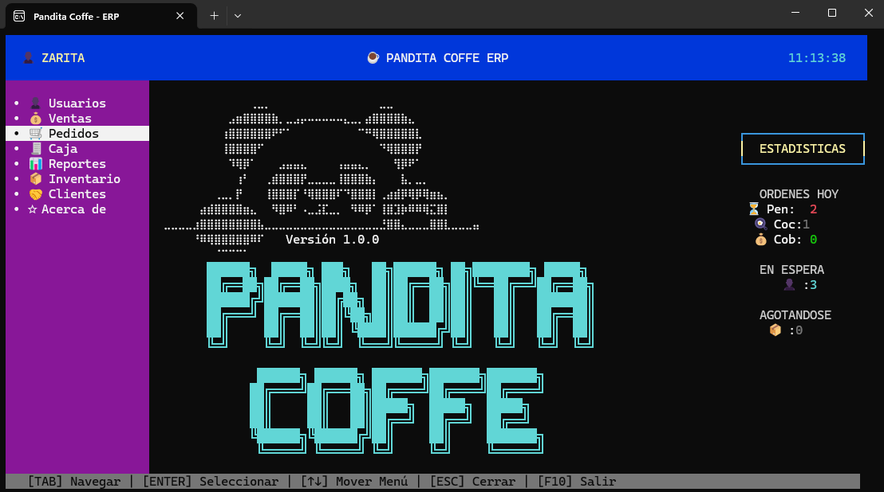
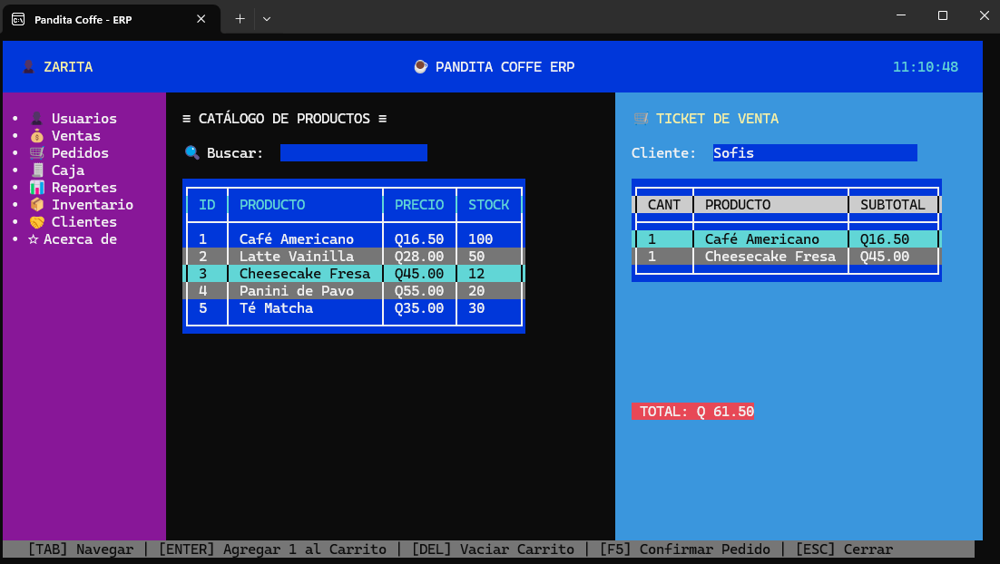
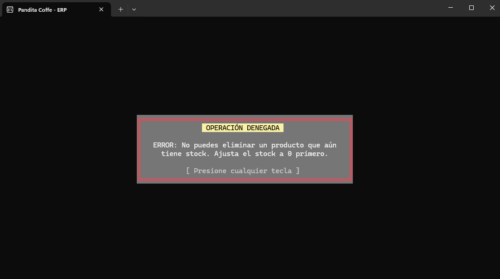
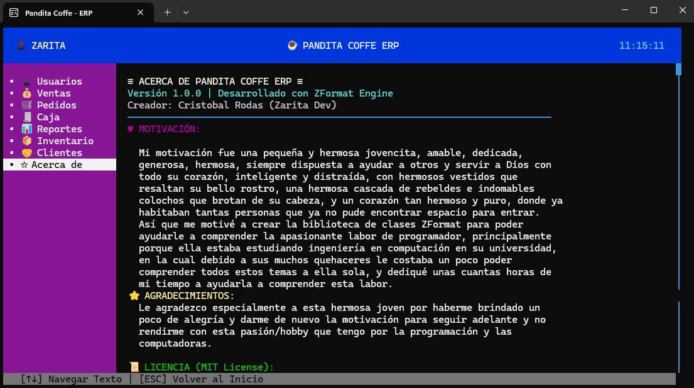

# 🚀 ZFormat Engine V2.0

**ZFormat** es un potente motor de renderizado y una biblioteca de componentes UI orientada a eventos para C# / .NET. Diseñada para construir interfaces de terminal (TUI) avanzadas, fluidas y de aspecto profesional en aplicaciones de consola.

En su versión 2.0, ZFormat abandona el simple formato de texto para convertirse en un **motor de doble búfer (Flicker-Free)**, permitiendo la creación de aplicaciones de gestión, ERPs y Puntos de Venta (POS) directamente en la consola de Windows sin parpadeos.

---

## ✨ Características Principales

* **Renderizado sin Parpadeos (`ZBuffer`):** El motor calcula los píxeles en memoria y solo redibuja los caracteres que cambiaron, logrando 0% de parpadeo (flickering).
* **Arquitectura Orientada a Eventos:** Manejo global de teclado (`OnGlobalKeyPressed`) y eventos por componente (`OnClick`, `OnRowSelected`, `OnValueChanged`).
* **Sistema de Layouts y Docking:** Soporte para contenedores anidados (`ZPanel`), anclaje automático (`ZDockMode.Fill`, `Left`, `Top`) y áreas de desplazamiento vertical (`ZScrollView`).
* **Componentes UI Interactivos:**
    * `ZInput`: Campos de entrada de texto con soporte de cursor y modo contraseña.
    * `ZTable`: Tablas interactivas con navegación por flechas y filtrado dinámico.
    * `ZButton`: Botones interactivos con gestión de foco.
    * `ZMessageBox`: Cuadros de diálogo modales con auto-ajuste de texto.
* **Persistencia Integrada (`ZStorage`):** Herramientas para guardar/cargar bases de datos en JSON y exportar reportes limpios a `.csv` (Excel).

---

## 🖼️ Galería: El Potencial de ZFormat

A continuación, capturas de **Pandita Coffe ERP**, una aplicación comercial completa construida 100% con ZFormat Engine:

### 1. Dashboards y Paneles Flotantes
Manejo de colores avanzados y posicionamiento absoluto.


### 2. Layouts Divididos (Punto de Venta)
Múltiples `ZPanel` conviviendo en pantalla con focos de teclado independientes.


### 3. ZMessageBox y Superposición de Capas
Cuadros de diálogo que flotan sobre la interfaz principal sin romper el dibujado de fondo gracias a `ZBuffer`.


### 4. ZScrollView (Vistas con Desplazamiento)
Vistas de contenido extenso con barras de desplazamiento dinámicas controlables por teclado.


---

## 💻 "Hola Mundo" con ZFormat

Crear una interfaz interactiva es tan fácil como instanciar la aplicación, crear un contenedor y agregar controles:

```csharp
using System;
using ZFormat.Core;
using ZFormat.Layouts;
using ZFormat.Controls;

namespace MiApp {
    class Program {
        static void Main(string[] args) {
            // 1. Inicializar el motor a 100x30
            ZApp app = new ZApp(100, 30); 

            // 2. Crear una vista principal (Panel)
            ZPanel vistaPrincipal = new ZPanel { 
                Dock = ZDockMode.Fill, 
                BackgroundColor = ConsoleColor.DarkBlue 
            };

            // 3. Agregar componentes
            ZLabel titulo = new ZLabel("¡Hola Mundo desde ZFormat!") { 
                X = 5, Y = 5, 
                ForegroundColor = ConsoleColor.Yellow,
                BackgroundColor = ConsoleColor.DarkBlue
            };

            ZButton btnSalir = new ZButton { 
                Text = " SALIR ", 
                X = 5, Y = 8, 
                IsFocusable = true 
            };

            // 4. Asignar eventos
            btnSalir.OnClick += () => app.Stop();

            vistaPrincipal.AddChild(titulo);
            vistaPrincipal.AddChild(btnSalir);

            // 5. Cargar vista, dar foco y arrancar el motor
            app.RootLayout.AddChild(vistaPrincipal);
            app.FocusedControl = btnSalir;
            
            app.Run(); // Inicia el ciclo de renderizado
        }
    }
}
```

---

## 📦 Instalación y Descarga

    Ve a la sección Releases de este repositorio.

    Descarga la última versión de ZFormat.dll.

    En tu proyecto de Visual Studio, haz clic derecho en "Dependencias" > "Agregar referencia de proyecto/Ensamblado" y selecciona el archivo .dll.

    ¡Agrega using ZFormat.Core; en tu código y comienza a crear!

---

## ♥️ Motivación del Proyecto

Este motor gráfico fue creado con un propósito muy especial: ayudar a una brillante estudiante de Ingeniería en Computación a comprender la apasionante labor del desarrollo de software. ZFormat abstrae la complejidad de crear interfaces, permitiendo a los nuevos programadores enfocarse en la lógica de negocio y enamorarse del código, demostrando que con dedicación se puede crear arte incluso en una simple terminal negra.

---

## 📜 Licencia

Este proyecto está distribuido bajo la Licencia MIT. Siéntete libre de utilizarlo, modificarlo, aprender de él y aplicarlo en tus propios proyectos académicos o comerciales. Consulta el archivo LICENSE para más detalles.